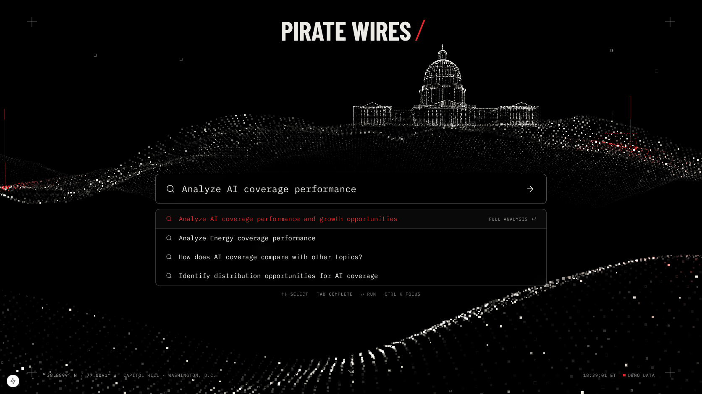

# Pirate Wires · Intelligence

Editorial intelligence and audience analytics. One continuous environment: the U.S. Capitol condenses out of a living landscape of white pixels and red data points, a terminal search sits at its centre, and scrolling settles the terrain into the lattice the Intelligence Database lives on. Submitting a query opens a five-stage research workspace.

> **Demo data.** Every article, author, URL and metric in this repo is fictional and generated for interface development. The research engine is a browser simulation until you connect a backend. The UI labels both everywhere they appear.



## Quick start

```bash
npm install
npm run dev        # http://localhost:3000
npm run build && npm start
```

Node 18.18+ (20+ recommended). No environment variables needed to run.

### Into your repo on a Mac (Cursor)

The ZIP's files sit at its root (no wrapper folder), so they drop straight into the repo:

```bash
cd ~/path/to/piratewiresxyz          # your clone
unzip ~/Downloads/piratewires-intelligence.zip -d .
npm install                           # installs exact versions from package-lock.json
npm run dev
```

Then open the folder in Cursor. `node_modules` and `.next` are not in the ZIP; `npm install` and the first `npm run dev` create them.

### Environment

Copy `.env.example` to `.env.local` only when you have a research backend:

```bash
cp .env.example .env.local
# NEXT_PUBLIC_RESEARCH_ENDPOINT=https://your-backend.example.com/research
```

Leave it unset to use the in-browser simulated engine on demo data.

## Stack

Next.js 15 (App Router) · React 19 · TypeScript · Tailwind CSS 3 · Three.js (raw, one draw call) · Recharts · Lucide. Fonts (Barlow Condensed, IBM Plex Mono, Inter) are bundled as woff2 files in `public/fonts` and declared in `app/globals.css`, so builds and pages make no font network calls. Licences: `public/fonts/LICENSE.md` (SIL OFL).

React Three Fiber was considered and left out. The scene is a single `THREE.Points` mesh with a custom shader, so R3F would add a dependency and a reconciler without adding capability.

## Structure

```
app/
  layout.tsx                 fonts, metadata
  globals.css                base styles, .pw-label / .pw-panel / .pw-lattice / .pw-check
  page.tsx                   landing → database (one page)
  research/page.tsx          research workspace (?q=…&ids=…)
  icon.svg
components/
  scene/CapitolScene.tsx     animated Capitol Hill (Three.js), scroll + cursor + reduced motion
  landing/
    LandingExperience.tsx    scroll orchestration, launch → /research
    Hero.tsx                 wordmark + search + scroll cue
    HudFrame.tsx             crosshairs, coordinates, clock
    LaunchOverlay.tsx        search → workspace transition
  search/
    CommandSearch.tsx        combobox: typing demo, suggestions, keyboard, ⌘K
    useAutoType.ts           human-paced typing hook
  database/
    IntelligenceDatabase.tsx filter / topic / sort / select / research-selected
    ArticleDrawer.tsx        article detail view
  research/
    ResearchWorkspace.tsx    layout + entrance
    StageTracker.tsx         5 stages, progress, expandable step logs
    ReportView.tsx           KPIs, findings w/ evidence, charts, articles, recommendations
    charts.tsx               topic comparison, weekly trend, channel CTR, distribution network
    useResearchRun.ts        reduces engine events into UI state
  shell/AppBar.tsx           compact nav + search for app surfaces
  brand/Wordmark.tsx
  ui/primitives.tsx          DemoBadge, Metric, Sparkline, SectionLabel, Kbd
lib/
  design/tokens.ts           colour, type, motion tokens (Tailwind + Three + charts read these)
  scene/geometry.ts          procedural point cloud: terrain, Capitol, blocks, markers
  scene/shaders.ts           vertex/fragment shaders (wave, assembly, scroll, pulses)
  scene/random.ts            seeded PRNG + noise
  data/types.ts              Article, Topic, Channel…
  data/articles.ts           DEMO records + getArticles() seam
  research/types.ts          research protocol (events, report shape, engine interface)
  research/engine.ts         SimulatedEngine + HttpEngine (SSE)
  research/analyze.ts        deterministic analysis used by the simulator
  search/suggestions.ts      prompt catalogue + ranking
docs/                        reference image + screenshots
```

## The Capitol scene

Everything is procedural; there are no model or texture files.

- `lib/scene/geometry.ts` builds about 60k points: a far ridge with the Capitol on a plateau, foreground dunes, flanking blocks (one painted red as a data cluster), and hollow-square HUD markers. Only the camera-facing half of the dome is generated, so additive blending stays legible.
- `lib/scene/shaders.ts` handles the wave motion, the load-in assembly (terrain rises, then the Capitol condenses), the scroll hand-off (land flattens, Capitol lifts away), twinkle and glints, depth fog, hollow and tiled pixels, and up to six red activity pulses at a time.
- `CapitolScene.tsx` frames the shot per aspect ratio (portrait tilts so the dome clears the search), adds eased cursor parallax, pauses on hidden tabs and once scrolled away, caps DPR at 1.75, and reduces density on small or low-core devices.
- **Reduced motion:** a single, fully assembled still frame, re-rendered only on resize. The typing demo completes instantly.
- **No WebGL:** the host gets `data-fallback="true"` and the page stays fully usable on black.

Tuning knobs: `LAYOUT` in `CapitolScene.tsx` (Capitol position and scale), `createTerrain` in `geometry.ts` (landform), `clusters` (baked red), and the pulse cadence in the render loop.

## Search

`⌘K` / `Ctrl K` / `/` focus · `↑ ↓` select · `Tab` complete · `Enter` run · `Esc` close.

On load it types `Analyze AI coverage performance`, then opens the four curated suggestions. Clicking or typing stops the demo at once, and the first keystroke replaces the demo text. It's an ARIA combobox (`role=combobox` + `listbox`, `aria-activedescendant`).

## Research engine: connecting a backend

The UI only speaks the protocol in `lib/research/types.ts`:

```ts
type ResearchEvent =
  | { type: "stage"; stage: StageId; status: "queued" | "running" | "complete" | "error"; summary?: string }
  | { type: "step";  stage: StageId; id: string; label: string; detail?: string; status: "running" | "done" }
  | { type: "report"; report: ResearchReport }
  | { type: "error"; message: string }
  | { type: "done" };
```

Set `NEXT_PUBLIC_RESEARCH_ENDPOINT` (see `.env.example`). `HttpEngine` then sends `POST { query, articleIds? }` and reads a `text/event-stream` with one `data: <ResearchEvent JSON>` per event. Return `provenance: "live"` in the report. The "Simulated run" banner and badges disappear automatically.

Stage ids: `discovery`, `distribution`, `performance`, `audience`, `synthesis`.

Replace `getArticles()` in `lib/data/articles.ts` with your CMS or analytics source, and set `demo: false` on real records.

## Design system

| Token | Value | Use |
|---|---|---|
| `void` | `#000` | page ground |
| `ink-900/850/800` | `#0A0A0B / #0F0F10 / #151517` | panels, hover |
| `paper` | `#EDEBE6` | text, particles |
| `mute` | `#8C8C89` | labels (6.4:1 on black) |
| `signal` | `#E3262B` | the one accent: focus series, active state, data clusters |

Type: Barlow Condensed 600/700 for display, IBM Plex Mono for interface, Inter for reading. Red marks the thing being asked about; everything else is off-white or grey.

## Responsive

The hero reframes the camera for portrait. On phones, suggestions wrap and key hints hide. Wide tables scroll inside their box. The research layout stacks below `lg`. The page has no horizontal scroll at 390px.

## Notes for Cursor

- The repo is self-contained; drop it in as the root of `piratewiresxyz`.
- `npm run typecheck` runs strict TypeScript.
- Landing first-load JS is about 370 kB (Three.js and Recharts). If you need it lighter, lazy-load `ArticleDrawer` (Recharts) with `next/dynamic`.
